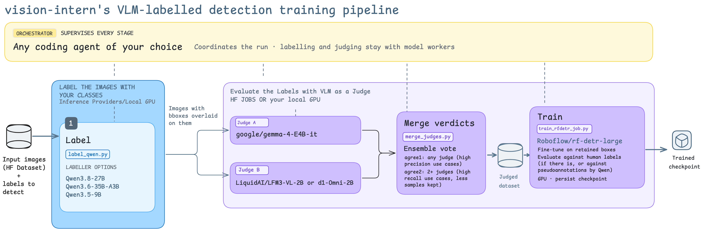

# vision-intern

This is the project in the [AI Engineer talk here](https://www.youtube.com/watch?v=dKcTBQzR7jI).

A Python toolkit for building vision pipelines: has my favorite models from human keypoint detection to zero-shot segmentation
as tools for your agents, you can give this tool to your agents to label datasets with VLMs, evaluate annotations with a VLM-as-judge, and train models — all from a few function calls.




## Current Limitations

- Training lacks segmentation support.
- If you have a use case with a lot of instances of an object to be detected it may not work. (This is experimental)

## Recommended architecture (model roles)

This workflow uses **separate models for separate roles**. Keep them on
separate processes/endpoints — do not collapse them into one model.

| Role | Size | What it does | Where it runs |
|---|---|---|---|
| **Orchestrator** | At least 27B+ (thinking) or your favorite agent (Codex, CC) | Drives the workflow, babysits the run, fixes errors, decides next steps. **Never labels or judges itself.** | The agent/subagent |
| **Labeller** | >9B VLM | Generates detections on the dataset (one model, the larger of the workers). | Remote (HF Inference Providers) or local server, it costs $0.5/1k images |
| **Judges** | Two smaller VLMs | Score/verify the labeller's detections. Use two judges for an ensemble/voting signal. | Remote or local servers |

Why the separation matters:

- **The orchestrator must not run inference.** Doing labelling or judging
  inside the orchestrator process thrashes its KV cache and degrades (or
  crashes) the agent that is supposed to be supervising the run. The
  orchestrator only calls the workflow functions and watches their output.
- **Labeller > judges in capacity.** Labelling is the harder generative task,
  so give it the larger worker (~7B). Judging each detection is a narrower
  verification task that smaller models (4-5B) handle well and cheaply.
- **Judges are pluggable and parallelizable.** Because the judge step takes a
  `model_id` (and optional `base_url`), you can run two small judges and
  combine their verdicts, rather than relying on a single large model.

Concretely, in the `label_dataset` / `judge_labels` / `train` calls:

- Point `label_dataset(..., model_id=<7B VLM>)` at your labeller endpoint.
- Point `judge_labels(..., model_id=<4-5B VLM>)` at one or more judge endpoints.
- Keep the orchestrating agent on a ~12B thinking model that only issues these
  calls and monitors progress — it should never be passed as a `model_id`.

## Install

Python 3.11 or newer is required (the project pins Python 3.12).

This is a [`uv`](https://docs.astral.sh/uv/) project:

```bash
uv sync                 # core: label / judge / merge (no torch)
uv sync --extra train   # adds torch, transformers, timm, albumentations, … for training
uv sync --extra viz     # adds supervision + Roboflow trackers (bbox + tracking viz)
uv sync --extra all     # train + viz + dev tooling (pytest, ruff)
```

Then run anything with `uv run` (e.g. `uv run python -m workflows.vlm_label …`).
A `requirements.txt` is also kept for `pip install -r requirements.txt`.

## Quick start

### 1. Label a dataset

Use any VLM to auto-detect objects in images. Works with local image
directories or Hugging Face datasets.

```python
from workflows import label_dataset

# Local images → COCO JSON
label_dataset(
    source="data/images",
    classes=["person", "car", "traffic light"],
    output="annotations.json",
)

# HF dataset → HF dataset with detections column
label_dataset(
    source="username/my-image-dataset",
    classes=["person", "car", "traffic light"],
    output="username/my-dataset-labeled",
    split="train",
    max_samples=1000,
    push_to_hub=True,
    backend="openai",
    base_url="http://localhost:8083/v1",   # llama-server
    api_key="sk-local",
)
```

`classes` is free-form — name whatever the task needs (document regions,
products, road signs, defects, …). Worked use cases live in
[`examples/`](examples/), one subfolder each (goal, classes, model-per-role,
commands, outputs); the seed [`examples/docvqa-media`](examples/docvqa-media/)
runs the full label → judge → train pipeline on HF Jobs.

### 2. Judge labels with a VLM

Score each detection and keep only the ones above a threshold.

```python
from workflows import judge_labels

judge_labels(
    source="username/my-dataset-labeled",
    output="username/my-dataset-judged",
    threshold=0.5,
    push_to_hub=True,
    backend="openai",
    base_url="http://localhost:8084/v1",   # small 4B judge server
    model_id="Qwen3-VL-4B-Instruct-Q8_0.gguf",
    api_key="sk-local-judge",
)
```

### 3. Train RF-DETR

Fine-tune a detection model on the curated dataset. This is a generalized
version of the [HF object-detection tutorial](https://huggingface.co/docs/transformers/tasks/object_detection):
lazy preprocessing, optional [Albumentations](https://albumentations.ai/)
augmentation, and COCO-style **mAP / mAR** evaluation via `torchmetrics`.

```python
from workflows import train

train(
    source="username/my-dataset-judged",  # or a local COCO directory
    model_id="Roboflow/rf-detr-large",
    epochs=20,
    batch_size=8,
    augment=True,          # use-case dependent — see note below; off via augment=False
    val_split="test",      # held-out split for mAP/mAR; None to skip eval
    push_to_hub=True,
    hub_model_id="username/my-detector",
    report_to="trackio",   # live metric tracking
)
```

Supported input formats (auto-detected):

- **HF dataset with an `objects` column** — the standard HF detection layout.
- **HF dataset with a `detections` column** — produced by `label_dataset` /
  `judge_labels` (Pascal-VOC boxes, converted automatically).
- **Local COCO directory** — `train/images/` + `train/labels.json`
  (and optional `val/`).

Any `AutoModelForObjectDetection` checkpoint works (RF-DETR, DETR, etc.); the
default is `Roboflow/rf-detr-large`. Local inference and training require
`transformers>=5.21` (for LFM3-VL); RF-DETR also uses `timm`.

**Augmentation is use-case dependent.** It defaults on (`augment=True`), but for
clean/uniform imagery or already-tight labels it can *hurt* — e.g. road-signs
trained markedly better with `--no-augment`. Assess per dataset; when unsure,
train both ways and compare mAP.

## Using it as an agent toolkit

The same functions are exposed as a discoverable, JSON-schema'd tool registry
for an in-process orchestrating agent — no MCP server, no per-tool boilerplate.
The agent enumerates tools, reads their schemas, and dispatches by name:

```python
import vision_agent as va   # or: from tools import get_tools, as_json_schema, call, configure, ToolConfig

# 1. Configure worker endpoints once, by role. Credentials live here — never
#    in a tool's schema, so the agent is never asked to fill an API key.
va.configure(
    labeller=va.ToolConfig(base_url="https://router.huggingface.co/v1",
                            model_id="Qwen/Qwen3-VL-8B-Instruct"),
    judge=va.ToolConfig(base_url="http://localhost:8084/v1",
                        model_id="Qwen3-VL-4B-Instruct-Q8_0.gguf"),
)

# 2. Discover. get_tools() is torch-free by default (the openai-backed VLM
#    tools, the label/judge workflows, and CPU helpers); pass
#    include_train=True to also surface the local-GPU tools + `train`.
specs = va.as_json_schema()        # [{name, description, parameters}, ...] — plain JSON Schema
print([t.name for t in va.get_tools()])

# 3. Dispatch by name. Hidden backend/model_id/base_url/api_key are injected
#    from the role config; pass them explicitly to override per call.
boxes = va.call("vlm_detect", image="photo.jpg", classes=["person", "car"])
```

`configure()` accepts `default` (VLM tools), `labeller` (`label_dataset`), and
`judge` (`judge_labels`, `d1_review`) roles. Any `ToolConfig` field left `None` falls through
to the function's own default (`model_id`), the HF Inference Providers URL
(`base_url`), or the `HF_TOKEN` / `OPENAI_API_KEY` env fallback (`api_key`). The
same three can be set via `VISION_AGENT_BACKEND` / `VISION_AGENT_MODEL` /
`VISION_AGENT_BASE_URL`.

## Inference backends

All VLM-powered tools (`vlm_detect`, `ocr_judge`) and
workflows (`label_dataset`, `judge_labels`) support two backends:

### `backend="openai"` (recommended for serving)

Uses the OpenAI Python client. A single code path that works with:

| Provider | `base_url` | `api_key` |
|---|---|---|
| **HF Inference Providers** | `https://router.huggingface.co/v1` (default) | Your HF token |
| **vLLM** | `http://localhost:8000/v1` | Server API key |
| **llama-server** | `http://localhost:8084/v1` | Server API key |
| Any OpenAI-compatible endpoint | Custom URL | Custom key |

```python
from tools import vlm_detect

vlm_detect(
    "photo.jpg",
    classes=["person", "car"],
    backend="openai",
    base_url="https://router.huggingface.co/v1",
    api_key="hf_...",
    model_id="Qwen/Qwen3-VL-8B-Instruct",
)
```

### `backend="transformers"` (local GPU)

Loads the model directly with `transformers` + `torch`. Models are cached
after the first load.

```python
from tools import vlm_detect

vlm_detect(
    "photo.jpg",
    classes=["person", "car"],
    backend="transformers",
    model_id="Qwen/Qwen2.5-VL-7B-Instruct",
)
```

## Tools reference

| Tool | Description |
|---|---|
| `detect` | RF-DETR closed-set detection (COCO 80 classes) |
| `instance_segment` | RF-DETR-Seg instance segmentation |
| `segment_from_bbox` | SAM3 — bbox prompt to high-quality masks |
| `segment_from_text` | Falcon-Perception — text prompt to zero-shot masks |
| `estimate_depth` | Depth Anything V2 — monocular relative depth |
| `estimate_pose` | Sapiens2 — dense 308-keypoint human pose |
| `grounded_detect` | MM-Grounding-DINO — open-vocabulary detection |
| `fast_segment` | EdgeTAM — lightweight bbox to mask |
| `ocr` | Selectable OCR models, including LightOnOCR-3-0.8B (`size="lighton"`) |
| `vlm_detect` | VLM instruction-prompted detection (any VLM) |
| `ocr_judge` | Pairwise OCR quality evaluation with a VLM-as-judge |
| `convert_bbox` | Convert bboxes between 6 formats |
| `validate_annotations` | Validate detection annotations for issues |
| `compute_stats` | Statistics for COCO annotation files |
| `annotate` | supervision-backed box + mask visualization (per-class / per-track colours) |
| `track_video` | Roboflow trackers + supervision multi-object tracking (boxes or instance masks) |

### LightOnOCR

Use [LightOnOCR-3-0.8B](https://huggingface.co/lightonai/LightOnOCR-3-0.8B)
with the `train` extra installed. The default prompt transcribes the image;
`grounding` adds labeled layout boxes (coordinates normalized to 0–1000) in
its text output. The return format remains `{"text": ..., "model": ...}`.

```python
from tools import ocr

text = ocr("page.png", size="lighton")
layout = ocr("page.png", size="lighton", prompt="grounding")
```

### Newer Qwen labeller options

All three models are selectable through the existing `model_id` API and `--model`
CLI argument. Existing defaults remain unchanged; these are additional options,
not new detection-quality benchmarks.

| Model option | Model card | Role |
|---|---|---|
| `Qwen/Qwen3.5-9B` | [Official card](https://huggingface.co/Qwen/Qwen3.5-9B) | Qwen labeller; default in `label_qwen.py` |
| `Qwen/Qwen3.6-35B-A3B` | [Official card](https://huggingface.co/Qwen/Qwen3.6-35B-A3B) | Image-capable Qwen labeller |
| `Qwen/Qwen3.8-27B` | [Official card](https://huggingface.co/Qwen/Qwen3.8-27B) | Image-capable Qwen labeller |

```python
from tools import vlm_detect

boxes = vlm_detect(
    "road.jpg",
    classes=["stop sign", "no entry sign"],
    model_id="Qwen/Qwen3.8-27B",  # Or Qwen/Qwen3.6-35B-A3B
    backend="openai",
    base_url="http://localhost:8000/v1",
)
```

The shared client requests non-thinking output for Qwen3.6 and Qwen3.8, using
`enable_thinking=False` locally and `chat_template_kwargs` on compatible
OpenAI-style endpoints. This keeps the token budget focused on the requested
box JSON. The detection parser also excludes `<think>` blocks and returns no
boxes from unfinished reasoning. A provider must support images and this
request option; check provider availability before selecting the HF router.
Use current Transformers/serving packages as described in the linked model
cards. The large checkpoints need appropriately sized inference hardware;
a CPU labelling job works only when inference is served remotely.

Use the same model IDs with `label_dataset`, agent role configuration, or
`jobs/label_qwen.py --model ...`. Discover the explicit options in
`tools.model_options.QWEN_LABEL_MODELS`. No hosted inference or GPU benchmark
of these new labellers was performed as part of adding the options.

### Recommended Liquid judge

Use [LiquidAI/LFM3-VL-2B](https://huggingface.co/LiquidAI/LFM3-VL-2B)
(1.92B parameters) as the small Liquid judge. Local inference requires
`transformers>=5.21.0` and uses the existing auto-model loader with custom-code
support. Re-evaluate judge accuracy and throughput when upgrading: recorded
example results predate this recommendation.

### System One labeling and judging

[`LiquidAI/d1-Omni-2B`](https://huggingface.co/LiquidAI/d1-Omni-2B) is supported
through its typed `system_one()` API with `backend="transformers"`. Set that
model ID in `label_dataset` / `judge_labels`, or call `d1_detect` / `d1_decide`
directly. Detection requires explicit classes; judges see numbered box overlays.

### d1 as an agent tool

`d1_decide` is a standalone inference tool for document field extraction,
classification, yes/no decisions, and image questions. Like the other local
model tools, it loads weights lazily, caches them, and returns dictionaries.

```python
from tools import call, get_tool

spec = get_tool("d1_decide").as_dict()  # Agent schema; no model load.
result = call(
    "d1_decide",
    image=None,
    state="ACME Ltd\nInvoice date: 2026-11-17\nTotal due: 42.50 EUR",
    questions={
        "company": {"type": "text", "instructions": "Who issued the invoice?"},
        "date": {"type": "date", "instructions": "What is the invoice date?"},
        "total": {"type": "number", "instructions": "What is the total due?"},
    },
)
print(result["answers"])
```

Include it in discovery with `get_tools(include_train=True)` or
`as_json_schema(include_train=True)`. The `train` extra supplies local inference
dependencies; calling this tool does not train a model. Direct Python calls are
also available via `from tools import d1_decide`.

The default model is `LiquidAI/d1-Omni-2B`; the registry can override it through
the default worker's `ToolConfig.model_id`. Extraction reads supplied text,
not image pixels, and returns typed values, spans, and `found` probabilities.
`found` measures presence, not correctness.

### d1 as a conservative judge option

Use `d1_review` to review proposed boxes with `LiquidAI/d1-Omni-2B`. It draws
numbered overlays from the original image, uses readable display names, and
supplies **no class descriptions**. It returns every box's verdict and score;
it does not remove detections or change their labels. Treat rejections as
review flags or one of the two ensemble votes. The standard pair is Gemma +
LFM3; choose Gemma + d1 to use d1 instead of LFM3. Do not add a third judge.

```python
from tools import call, configure, get_tool, ToolConfig

configure(judge=ToolConfig(model_id="LiquidAI/d1-Omni-2B"))
schema = get_tool("d1_review").as_dict()
aliases = {"enter_left_lane": "enter left lane"}
verdicts = call(
    "d1_review",
    image="road.jpg",  # Original image, before drawing boxes.
    detections=[{"label": "enter_left_lane", "bbox": [10, 20, 100, 150]}],
    label_aliases=aliases,
)
```

The direct Python equivalent is `from tools import d1_review`. Agent discovery
requires `get_tools(include_train=True)` or `as_json_schema(include_train=True)`;
local inference uses the `train` dependency extra. Aliases are optional:
unmapped labels have underscores replaced with spaces, but abbreviations need
an explicit mapping. Output indices refer to the original detection order.
The existing workflow also accepts `model_id="LiquidAI/d1-Omni-2B"` with
`backend="transformers"`; use `class_descriptions={}` to disable descriptions.
That filtering workflow has its own retention policy; `d1_review` only scores.

## Workflows reference

| Workflow | Description |
|---|---|
| `label_dataset` | Auto-label images with a VLM for object detection |
| `judge_labels` | Score and filter labels with a VLM-as-judge |
| `train` | Fine-tune RF-DETR on labeled data |

All workflows support both **local directories** (COCO format) and
**Hugging Face datasets** as input and output.

## Visualization & tracking (`viz` extra)

[`supervision`](https://supervision.roboflow.com) and the
[`trackers`](https://github.com/roboflow/trackers) package back the bbox
visualization and multi-object tracking tools. Install with `uv sync --extra viz`.
Both bridge to the repo's plain detection-dicts
(`{"label", "score", "box"/"bbox", ...}`) via `tools.sv_convert`, so any
detector here (`detect`, `grounded_detect`, `vlm_detect`) feeds straight in.

```python
from tools import annotate, track_video

# Still image: draw boxes + labels with per-class colours (drop-in for the
# pure-PIL tools.bbox_viz.draw_detections; also takes judge `verdicts`).
annotate("frame.jpg", detections, verdicts=verdicts).save("annotated.png")

# Video: detect (or instance-segment) every frame, associate with a Roboflow
# tracker, and write an annotated copy with stable per-object colours, ids,
# motion trails — and masks when a segmentation detector is used.
track_video("clip.mp4", detector="rfdetr", tracker="bytetrack")      # boxes
track_video("clip.mp4", detector="rfdetr-seg")                       # tracked instance masks
track_video("clip.mp4", detector="falcon", classes=["red car"])      # open-vocab masks
```

Per-frame detectors: `rfdetr` (RF-DETR boxes), `grounded` (MM-Grounding-DINO,
open-vocab boxes), `vlm` (VLM-prompted boxes), `rfdetr-seg` (RF-DETR-Seg instance
masks) and `falcon` (Falcon-Perception, open-vocab masks). Trackers associate on
boxes (derived from masks for the segmentation detectors) and the masks ride
along, so tracked instances keep a stable colour + id frame to frame.

```bash
# Annotate one image from a detections JSON file
python -m tools.sv_viz frame.jpg -d dets.json --out annotated.png

# Track objects through a video (bytetrack | sort | ocsort | botsort)
python -m tools.track_video clip.mp4 --detector grounded --classes "car,person" \
    --tracker bytetrack --out tracked.mp4
```

`track_video` needs both the `viz` extra and a detector from the `train` extra
(torch); the still-image `annotate` runs on a CPU-only `viz` install.

## CLI usage

Each workflow can also be run from the command line:

```bash
# Label (7-8B labeller, here via HF Inference Providers)
python -m workflows.vlm_label \
    --source username/my-image-dataset \
    --classes "person,car,traffic light" \
    --output username/my-dataset-labeled --push-to-hub \
    --backend openai --base-url https://router.huggingface.co/v1 \
    --api-key hf_... --model Qwen/Qwen3-VL-8B-Instruct \
    --split train --max-samples 100

# Judge (small 4B judge, here on a local llama-server)
python -m workflows.vlm_judge \
    --source username/my-dataset-labeled \
    --output username/my-dataset-judged --push-to-hub \
    --backend openai --base-url http://localhost:8084/v1 \
    --api-key sk-local-judge --model Qwen3-VL-4B-Instruct-Q8_0.gguf \
    --threshold 0.5

# Train (mAP/mAR eval on a held-out split, push to the Hub)
python -m workflows.train_rfdetr \
    --source username/my-dataset-judged --val-split test \
    --annotation-source detections \
    --model Roboflow/rf-detr-large --epochs 20 --batch-size 8 \
    --output-dir checkpoints/my-detector
```

## Example: full pipeline with role-separated models

Each role uses its own model (see "Recommended architecture" above). The
labeller is the larger worker; the judge is a small, cheap verifier. The
~12B orchestrator drives this script and is **never** used as a `model_id`
here. (For a fully worked multi-model run on HF Jobs, see
[`jobs/README.md`](jobs/README.md).)

Serve a small judge locally with llama-server (runs alongside the
orchestrator with little VRAM):

```bash
llama-server \
    --model Qwen3-VL-4B-Instruct-Q8_0.gguf \
    --mmproj mmproj-F16.gguf \
    --host 0.0.0.0 --port 8084 \
    --n-gpu-layers 99 --ctx-size 8192 \
    --api-key sk-local-judge
```

Then run the pipeline from Python:

```python
from workflows import label_dataset, judge_labels, train

# Labeller: ~7-8B VLM via HF Inference Providers (remote)
LABELLER = dict(
    backend="openai",
    base_url="https://router.huggingface.co/v1",
    api_key="hf_...",
    model_id="Qwen/Qwen3-VL-8B-Instruct",
)

# Judge: small ~4B VLM on a local llama-server
JUDGE = dict(
    backend="openai",
    base_url="http://localhost:8084/v1",
    api_key="sk-local-judge",
    model_id="Qwen3-VL-4B-Instruct-Q8_0.gguf",
)

# Step 1: label
label_dataset(
    source="username/my-image-dataset",
    classes=["person", "car", "traffic light"],
    output="username/my-dataset-labeled",
    split="train",
    max_samples=1000,
    push_to_hub=True,
    **LABELLER,
)

# Step 2: judge
judge_labels(
    source="username/my-dataset-labeled",
    output="username/my-dataset-judged",
    threshold=0.5,
    push_to_hub=True,
    **JUDGE,
)

# Step 3: train
train(
    source="username/my-dataset-judged",
    epochs=20,
    batch_size=4,
)
```

## License

MIT
